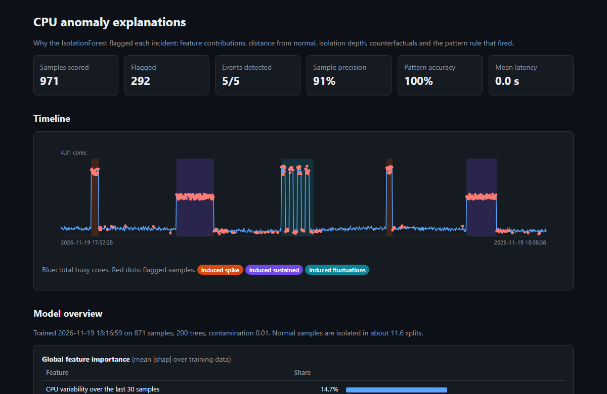
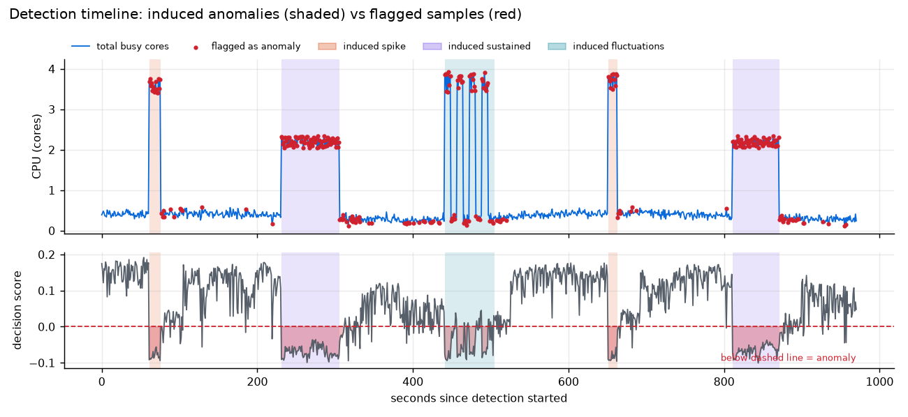
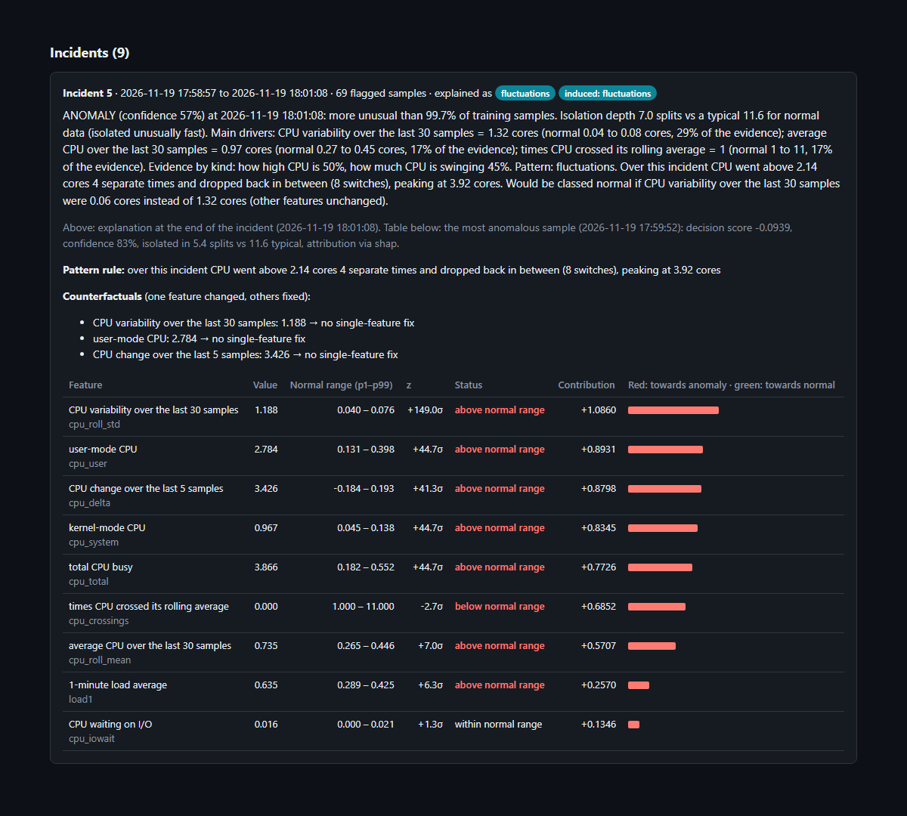
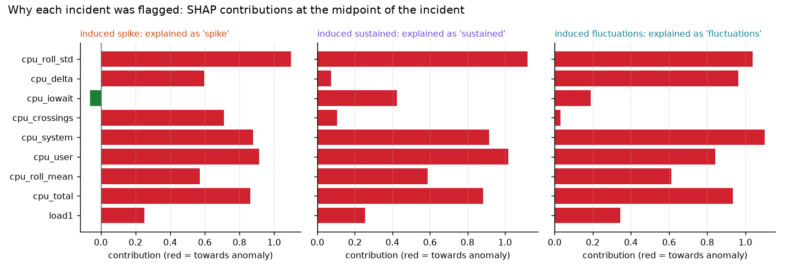
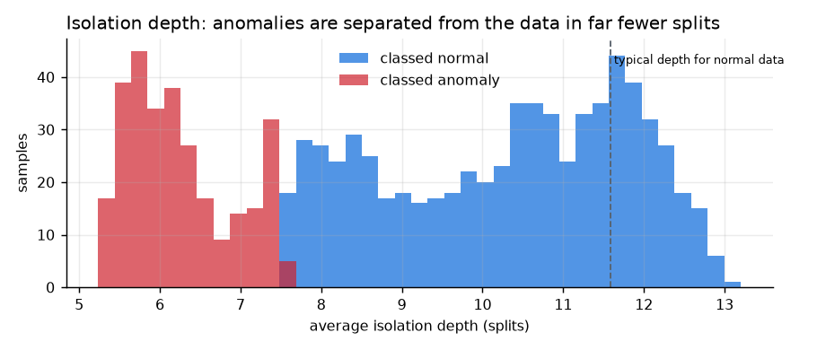
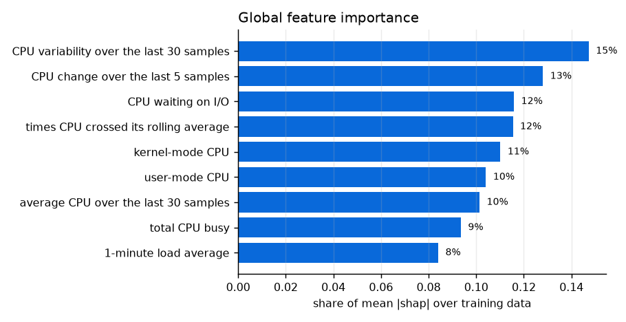
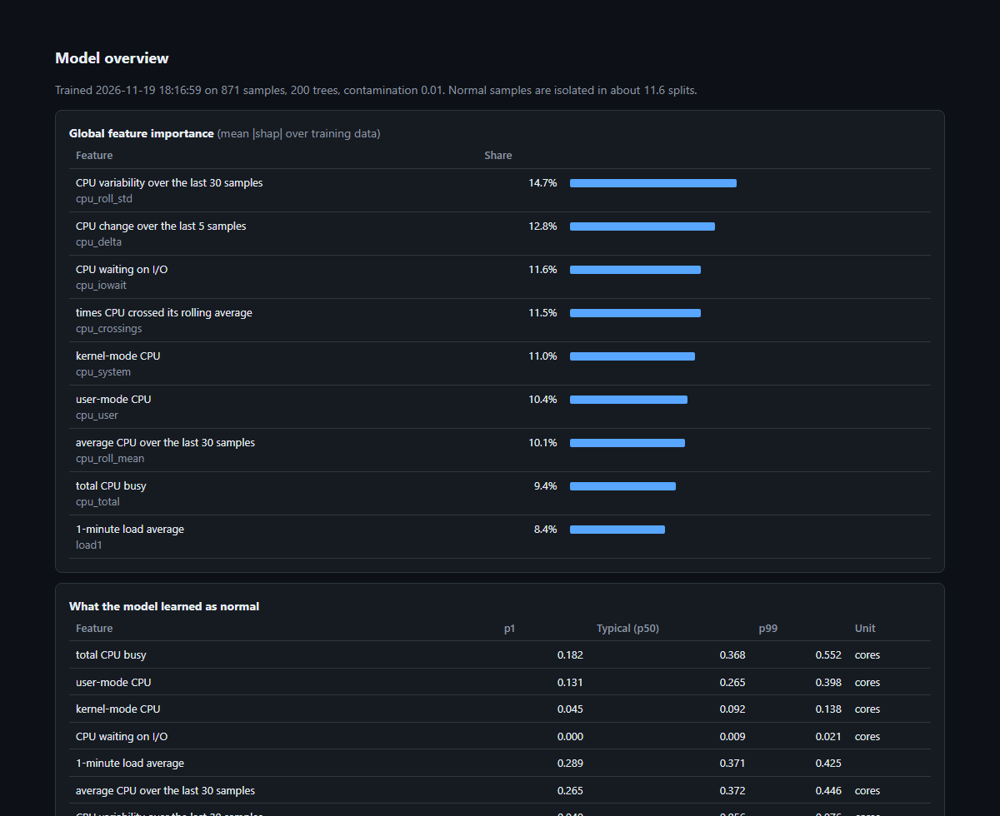

# CPU Metrics Anomaly Detection with Explainability

Real-time CPU anomaly detection with an IsolationForest, plus an explainability
layer that says **why** each sample was flagged, not just that it was.



## Architecture

```
node_exporter ──► Prometheus ──► anomaly_detection ──► Pushgateway ──► Prometheus ──► Grafana
                                   │  train.py   (learn normal + baseline)
                                   │  detect.py  (score + explain every sample)
                                   └► data/explanations.jsonl ──► report.py ──► explanation_report.html
anomaly_induction ── CPU load ──► (seen by node_exporter)
                  └► data/anomaly_schedule.json (ground-truth labels) ──► evaluate.py
```

## Results

The model was trained on 900 s of normal load (871 usable samples after the
rolling-window warm-up). It was then run on 1,000 s of load containing 5
labelled anomalies: 2 spikes, 2 sustained loads and 1 fluctuation burst. These
figures come from the reproducible offline demo (`python src/demo_offline.py`),
which uses synthetic CPU data.

| Metric | Value |
|---|---|
| Anomalies detected (event recall) | **5 / 5 (100%)** |
| Sample precision | **91.4%** (267 of 292 flagged samples fall inside an anomaly or the 30 s after it) |
| Sample recall | **93.1%** of samples inside anomaly windows were flagged |
| Sample F1 | **0.92** |
| Detection latency | **0 s**: every anomaly was flagged on its first sample |
| Explained pattern correct | **5 / 5 (100%)**: the incident label matched the induced type |

| Induced anomaly | Duration | Flagged samples | Explained as |
|---|---|---|---|
| spike | 15 s | 24 | spike |
| sustained | 75 s | 93 | sustained |
| fluctuations | 64 s | 56 | fluctuations |
| spike | 12 s | 19 | spike |
| sustained | 60 s | 75 | sustained |



**Where it is wrong.** The 25 false positives are borderline samples (decision
scores just below 0) in quiet periods. They come from the 1-minute load average
decaying slowly after heavy load, and from troughs in the baseline. The
explainer labels them `drop`, which makes them easy to recognise and filter.
That is a false-positive rate of about 2.5% of normal samples, compared with the
configured contamination of 1%.

**Caveat.** Synthetic data is cleaner than a real machine. Run the full Docker
stack and then `src/evaluate.py` to measure performance on real CPU load.

## How the model explains itself

Every scored sample gets the following evidence:

| Evidence | What it tells you |
|---|---|
| **Verdict and confidence** | Decision score, confidence (50% at the boundary), and rarity: how many training samples look more normal than this one |
| **Isolation depth** | IsolationForest flags points that random splits isolate quickly. Each sample's average tree depth is compared with the typical depth for normal data |
| **Feature contributions** | SHAP (TreeExplainer) values, oriented so positive means "pushes towards anomaly". Falls back to occlusion if `shap` is missing |
| **Evidence by kind** | Contributions grouped into level (how high), change (how fast), variability (how much it swings) and I/O |
| **Baseline comparison** | Each feature against the p1–p99 range seen in training, with a z-score |
| **Counterfactuals** | The value a driver would need for the sample to be normal (others fixed), or how far the whole sample must move back to typical |
| **Pattern** | `spike`, `sustained`, `fluctuations`, `drop` or `point`, labelled from the shape of the whole incident, with the rule that fired |
| **Narrative** | All of the above in one plain-language paragraph |

### One incident, fully explained

The report has one card per incident. It shows the final narrative, the
pattern rule that fired, counterfactuals, and every feature's value, normal
range, z-score and SHAP contribution:



### Local explanations: why each kind of anomaly was flagged

SHAP contributions at the midpoint of one incident of each type. A spike and a
fluctuation burst are driven by rapid change (`cpu_delta`) and variability. A
sustained load at its midpoint is flat, so `cpu_delta` and `cpu_crossings`
barely contribute and the level features carry the evidence.



### Isolation depth: the model's own reasoning

IsolationForest isolates anomalies in fewer random splits. Flagged samples sit
at about 5–7.5 splits. Normal samples sit near the typical depth of 11.6.



### Global explanation: what the model learned

Feature importance over the training data, plus the normal range of each
feature that every local explanation compares against:





## Features

A single CPU number can only show that a value is unusual. The model therefore
uses features that describe the shape of recent load:

| Feature | Meaning |
|---|---|
| `cpu_total` | Busy cores (all non-idle modes) |
| `cpu_user`, `cpu_system`, `cpu_iowait` | Busy cores by mode |
| `load1` | 1-minute load average |
| `cpu_roll_mean`, `cpu_roll_std` | Mean and standard deviation of `cpu_total` over the last 30 samples |
| `cpu_delta` | Change in `cpu_total` over the last 5 samples |
| `cpu_crossings` | How often `cpu_total` crossed its rolling mean in the window |

## Run it

### Offline demo (no Docker)

```bash
python -m venv .venv
.venv/Scripts/python -m pip install -r requirements.txt     # macOS/Linux: .venv/bin/python
.venv/Scripts/python src/demo_offline.py
```

The demo trains on synthetic normal load, injects 5 labelled anomalies and
explains every sample. It then prints the evaluation and writes
`data/demo/explanation_report.html`.

### Full stack

```bash
docker compose up --build
```

1. `anomaly_detection` collects `TRAIN_DURATION` seconds (default 300) of normal
   load, trains, and then scores and explains every second.
2. When the model exists, `anomaly_induction` waits `INDUCTION_WARMUP` seconds
   and then runs `ANOMALY_COUNT` labelled anomalies. Each one is a spike,
   sustained load or fluctuations, generated by busy-loop worker processes.
3. Open Grafana at http://localhost:3000 (admin/admin). The **CPU Anomaly
   Detection: Explainability** dashboard is provisioned automatically. It shows
   the verdict, confidence, explained pattern, isolation depth, feature
   contributions and z-scores.

Afterwards:

```bash
docker compose run --rm anomaly_detection python src/evaluate.py   # precision / recall / pattern accuracy
docker compose run --rm anomaly_detection python src/report.py     # data/explanation_report.html
```

### Regenerating the README figures

```bash
pip install matplotlib
python docs/make_figures.py            # from data/demo; pass "data" to use a live run
```

## Outputs (in `data/`)

| File | Contents |
|---|---|
| `trained_model.pkl` | Model, scaler and explainer baseline |
| `global_explanation.json` | Global feature importance and the learned normal ranges |
| `realtime_data.csv` | Raw training snapshots |
| `explanations.jsonl` | One explanation per scored sample (full detail for anomalies) |
| `anomaly_schedule.json` | Induced anomalies with real start and end times |
| `evaluation.json` | Detection and explanation accuracy against the schedule |
| `explanation_report.html` | Self-contained report: timeline, model overview and one card per incident |

## Metrics pushed to Prometheus

`cpu_anomaly_detection_score`, `cpu_anomaly_detection_is_anomaly`,
`cpu_anomaly_confidence`, `cpu_anomaly_rarity`, `cpu_anomaly_path_length`,
`cpu_anomaly_typical_path_length`, `cpu_anomaly_feature_value{feature}`,
`cpu_anomaly_feature_contribution{feature}`, `cpu_anomaly_feature_zscore{feature}`,
`cpu_anomaly_pattern{pattern}`.

## Configuration

All settings are environment variables (see `src/config.py`). The main ones are:

| Variable | Default | |
|---|---|---|
| `TRAIN_DURATION` | 300 | Seconds of live data to train on |
| `CONTAMINATION` | 0.01 | Expected anomaly share in the training data |
| `ROLL_WINDOW` / `DELTA_LAG` | 30 / 5 | Rolling-feature window and change lag, in samples |
| `INCREMENTAL_TRAINING` | false | Retrain even if a model exists |
| `HISTORICAL_TRAINING` | false | Train from `HISTORICAL_DATA_PATH` instead of live data |
| `ANOMALY_COUNT` / `ANOMALY_GAP` | 6 / 60 | Number of induced anomalies and the normal gap between them |
| `EVAL_TOLERANCE` | 30 | Seconds after an anomaly ends during which a flag still counts as correct |

A `trained_model.pkl` from before the explainability layer (a bare
`(model, scaler)` tuple) is detected and retrained automatically.
